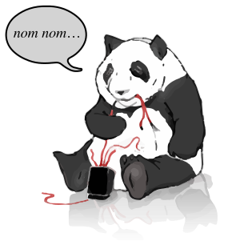

# Pickles the panda

<p align="center">
  
</p>

Pickles is a panda mascot for maintenance and error pages. The image is a visual pun on **“Please bear with us”**: a bear accompanies a request for patience while a site is unavailable.

The transparent artwork includes a speech bubble and a faded reflection, and works on light and dark backgrounds.

`pickles.ai` is the editable Adobe Illustrator master. `pickles.svg` is the portable vector export and the source for all bitmap renders. After editing the master, export the updated SVG before regenerating the bitmaps.

The export tooling lives in `tools/`, and this README lives in `.github/` to keep the repository root compact. Run the commands below from the repository root.

## Downloads

Transparent PNGs are in [`renders/png/`](../renders/png/) and lossless WebP images are in [`renders/webp/`](../renders/webp/). Both formats are available at widths of **256, 512, 1024 and 2048 pixels**. Heights follow the artwork's proportions; images are neither stretched nor padded. For example, `pickles-512.png` is 512 pixels wide.

The exports preserve the reflection fade and the subtle outline rims. They include no embedded attribution, EXIF or XMP metadata. `renders/manifest.json` records the source SVG checksum and the rendered dimensions.

## Sample error page

[`sitedown.html`](../sitedown.html) is a responsive example for phones, tablets and desktop screens. It follows the device's light or dark theme and works without JavaScript or external fonts. Copy it together with `pickles.svg` into the same folder, then customise the message and contact details for your site.

## Regenerate the bitmaps

Install Node.js 24, then run:

```sh
npm --prefix tools ci
npm --prefix tools run render
```

Commit the updated SVG and generated `renders/` files together when regenerating locally.

The **Render bitmaps** GitHub Action runs on the default branch when the SVG, renderer, dependency files or workflow change, and can also be run manually on that branch. It provides a downloadable artifact and commits changed renders back to the branch. The workflow needs GitHub Actions to be enabled, and default-branch rules must allow its generated-file commits. If those commits are blocked, the downloadable artifact is still available.

## Licence

This repository, including the artwork and export tooling, is dedicated to the public domain under [CC0 1.0 Universal](https://creativecommons.org/publicdomain/zero/1.0/). You may copy, modify and use it commercially without attribution. See [`LICENSE`](LICENSE) for the full terms.
